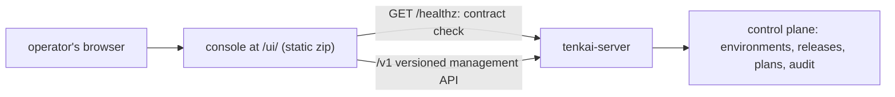

# tenkai-console

**Operate a Tenkai delivery fleet from the browser, through the same versioned
API and audit record as the CLI.**

[](https://github.com/Sannrox/tenkai-console/actions/workflows/ci.yml)
[](https://github.com/Sannrox/tenkai-console/releases)
[](LICENSE)

[Try it](#try-it) · [Sign-in](#sign-in) · [Releasing](RELEASING.md) ·
[Changelog](CHANGELOG.md) · [Tenkai](https://github.com/Sannrox/tenkai)

The web console for the [Tenkai](https://github.com/Sannrox/tenkai) delivery
control plane. It watches a fleet of environments, publishes and promotes
releases, subscribes environments to channels, and approves and applies plans.
It is a client of Tenkai's versioned public API only: anything the console
does, `tenkaictl` can do with the same contract and audit record. The design
is recorded in Tenkai
[ADR 0031](https://github.com/Sannrox/tenkai/blob/main/docs/decisions/0031-web-console.md).

- **One client of the public API.** No private endpoints; Tenkai owns
  authentication, authorization, approval, and audit, and the console never
  re-implements them in the browser.
- **Contract-pinned.** Types are generated from an API schema vendored from a
  signed Tenkai release; at startup the console requires `/healthz` to list
  the contract it was built for and shows "server too old" otherwise.
- **One zip, any prefix.** The build uses only relative URLs and finds the API
  two levels above its own entry module, so the same zip works at `/ui/` and
  at `/<prefix>/ui/` behind a reverse proxy.
- **Air-gap friendly.** The bundle loads no assets from outside its origin;
  with a pasted token it talks only to its own origin.
- **Tokens stay in memory.** OIDC with Authorization Code and PKCE; only the
  PKCE verifier and `state` survive the redirect.
- **Budgeted.** CI enforces initial JS at or under 200 KB gzipped and
  fleet-scale table load budgets.

## Try it

From a fresh clone (toolchain: Node and pnpm, pinned by `packageManager` in
`package.json`):

```sh
git clone https://github.com/Sannrox/tenkai-console && cd tenkai-console
pnpm install
pnpm build
```

`pnpm build` type-checks and writes the static bundle to `dist/`:

```text
✓ built in 582ms
```

The console gates every screen on a reachable, compatible server, so the full
experience needs a running `tenkai-server`. Point the dev server at one:

```sh
TENKAI_URL=http://127.0.0.1:8080 pnpm dev   # proxies /v1 and /healthz to tenkai-server
```

```text
  VITE v8.3.1  ready in 476 ms
  ➜  Local:   http://localhost:5173/
```

Without a server the page stays at "Connecting". In production you do not run
the console yourself: Tenkai pins a release of this repository and serves it
at `/ui/` on the API's origin (see [How it ships](#how-it-ships)).

## How it works



`api/tenkai-http-v1.schema.json` is Tenkai's published HTTP contract,
vendored from a signed Tenkai release (or a Tenkai `main` commit ahead of
one) and pinned by ref and SHA-256 in `api/tenkai.pin`; `src/api/tenkai.gen.ts` is generated from it, and server
responses are validated at runtime. At startup the console requires
`/healthz` to list the contract it was built for and shows "server too old"
otherwise. A management action whose response is lost reads as unknown, never
as success, and is never retried silently.

## How it ships

Each signed annotated tag `vX.Y.Z` (equal to the `package.json` version)
publishes `tenkai-console-vX.Y.Z.zip`, `SHA256SUMS`, an SBOM, provenance
attestations, a family release manifest, and a GitHub Release whose notes
come from CHANGELOG. Tenkai pins one release in `ui/console.pin` by tag and
SHA-256 and serves it at `/ui/` on the API's origin behind a `ui` feature.
This repository does not publish a container image. See [RELEASING.md](RELEASING.md).

Verify a release before pinning it:

```sh
tag=vX.Y.Z
gh release download "$tag" -R Sannrox/tenkai-console
sha256sum -c SHA256SUMS
gh attestation verify "tenkai-console-$tag.zip" -R Sannrox/tenkai-console
```

## Sign-in

The console signs in with OIDC (Authorization Code with PKCE, public client)
using the settings `tenkai-server` serves at `GET /v1/auth/oidc`, configured by
`TENKAI_OIDC_CONFIG` (see Tenkai's `docs/auth-request-context.md`). Register
these with the identity provider for client `tenkai-console`:

- redirect URI: `<public console URL>/auth/callback`, for example
  `https://tenkai.example.com/ui/auth/callback`;
- post-logout redirect URI: the console URL itself;
- web origin (CORS): the console's origin, for example
  `https://tenkai.example.com`, because the browser calls the provider's
  discovery and token endpoints directly. A Content-Security-Policy in front of
  the console must allow the issuer in `connect-src`;
- access tokens as signed JWTs (RS256 or ES256) whose `aud` includes the
  audience in Tenkai's OIDC config, carrying the groups claim Tenkai maps to
  grants.

Tokens stay in memory. While the tab is open, the console renews the session
with the refresh token shortly before the access token expires, when the
provider issues one; otherwise the session ends at expiry. A reload signs in
again. Only the PKCE verifier and
`state` survive the redirect, in `sessionStorage`. Servers without OIDC accept
a pasted bearer token instead, also held in memory.

### Host account over SSH

On a Linux server the default sign-in is the host account (Tenkai
[ADR 0047](https://github.com/Sannrox/tenkai/blob/main/docs/decisions/0047-host-identity.md)).
Forward Tenkai's Unix socket and open the console on loopback:

```sh
ssh -L 8080:/run/tenkai/tenkai.sock <server>
# then open http://localhost:8080/ui/
```

At startup the console asks `GET /v1/auth/me` without a credential. When the
server identifies the connection as a host account, the console is signed in as
that user; the account menu and Access show the user, the OS groups that
granted access, and the capabilities. The browser holds no credential, and
closing the tunnel signs out. Without OIDC, the sign-in screen shows the
forward command next to the token form.

## API types

`api/tenkai-http-v1.schema.json` is Tenkai's published HTTP contract, vendored
from a signed Tenkai release. `api/tenkai.pin` records the ref and the schema's
SHA-256 (`<ref> <sha256>`). `src/api/tenkai.gen.ts` is generated from it.

Console screens for a Tenkai feature land before the Tenkai release that ships
it, so the ref may also be a full commit on Tenkai `main`. A commit has no
published checksum: sync requires it to be on `main` and to keep the
`tenkai.http.v1` contract id, and the runtime `/healthz` check still guards
version skew. Pin the release tag once it is cut.

```sh
pnpm api:sync <vX.Y.Z>   # fetch the release schema, check SHA256SUMS, pin and regenerate
pnpm api:sync <commit>   # vendor the schema at a full commit on tenkai main, pin and regenerate
pnpm api:check           # CI: fail when the schema does not match the pin or types are stale
pnpm api:drift           # scheduled: fail when the pin is behind tenkai's latest release
                         # (a commit pin is current while it contains that release)
```

## Develop

```sh
pnpm install
TENKAI_URL=http://127.0.0.1:8080 pnpm dev   # proxies /v1 and /healthz to tenkai-server
pnpm typecheck && pnpm lint && pnpm format:check && pnpm test && pnpm build
VERSION=v0.0.0-dev pnpm package             # release/ zip + SHA256SUMS
pnpm perf:bundle                             # CI: initial JS ≤ 200 KB gzipped, ≤ 10% over perf/bundle-baseline.json
pnpm perf:load                               # CI: fleet-scale table budgets (needs `pnpm exec playwright install chromium`)
```

Stack: TypeScript (strict), React, Vite, ArkType for runtime validation of
server responses, Oxlint (type-aware) and Oxfmt, Vitest, pnpm.

## License

Apache-2.0.
